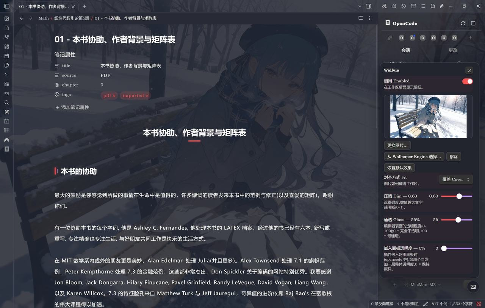
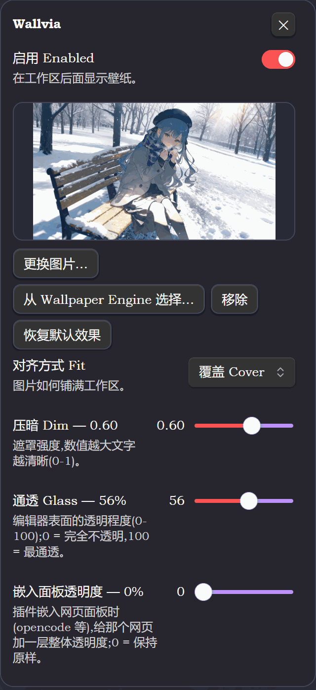

<div align="center">

# Wallvia for Obsidian

**Bring your Wallpaper Engine everywhere.**

鎶?vault 閲岀殑鍥剧墖锛屾垨 Wallpaper Engine 宸蹭笅杞界殑澹佺焊璁句负 Obsidian 宸ヤ綔鍖鸿儗鏅?鈥斺€?缂栬緫鍖恒€佷晶鏍忎笌宓屽叆缃戦〉涓€璧峰彉鎴愭瘺鐜荤拑锛屾殫鑹蹭寒鑹查兘閫傜敤銆?
[](../LICENSE)


涓枃 路 [English](README.md)

</div>



<sub>澹佺焊鍦ㄧ紪杈戝尯鑳屽悗閫忓嚭锛屽乏鍙充晶鏍忎笌鏍囩鍖烘槸姣涚幓鐠冿紝姝ｆ枃鏂囧瓧渚濈劧娓呮櫚銆?/sub>

| 椤圭洰 | 璇存槑 |
|:--|:--|
| 鎻掍欢 ID | `wallvia` |
| 褰撳墠鐗堟湰 | `1.0.0` |
| 鏈€浣庣増鏈?| Obsidian `1.4.0` |
| Wallpaper Engine | Windows 妗岄潰绔?|
| 婧愮爜浣嶇疆 | 浠撳簱鏍圭洰褰曚笅鐨?`obsidian/` |

---

## 鐩綍

- [鍔熻兘](#鍔熻兘)
- [瀹夎](#瀹夎)
- [浣跨敤](#浣跨敤)
- [Wallpaper Engine 澹佺焊鍒楄〃](#wallpaper-engine-澹佺焊鍒楄〃)
- [瑙嗛澹佺焊](#瑙嗛澹佺焊)
- [鏁堟灉](#鏁堟灉)
- [璁剧疆](#璁剧疆)
- [甯歌闂](#甯歌闂)
- [鍗歌浇涓庤繕鍘焆(#鍗歌浇涓庤繕鍘?
- [宸茬煡闄愬埗](#宸茬煡闄愬埗)
- [寮€鍙戜笌娴嬭瘯](#寮€鍙戜笌娴嬭瘯)
- [璁稿彲](#璁稿彲)

---

## 鍔熻兘

| | 鍔熻兘 |
|:--|:--|
| 馃柤锔?| 閫夋嫨 vault 鍥剧墖锛屾垨浠庡凡涓嬭浇鐨?Wallpaper Engine 澹佺焊閲屾寫涓€寮?|
| 馃З | 澹佺焊鍒楄〃鎸夌獥鍙ｅ搴﹁嚜閫傚簲鍒嗗垪锛屾敮鎸佹悳绱€佹柟鍚戦敭閫夋嫨銆佸師鍥惧垎杈ㄧ巼寰芥爣 |
| 馃獰 | 缂栬緫鍖恒€佸乏鍙充晶鏍忋€佷互鍙婃彃浠跺祵鍏ョ殑缃戦〉闈㈡澘鏀寔鐜荤拑鏁堟灉 |
| 馃寳 | 鏆楄壊 / 浜壊涓婚鑷姩閫傞厤 |
| 馃帥锔?| 鍙皟 Fit銆丏im銆丟lass銆丅lur銆佸浘鐗囦笉閫忔槑搴︺€佸祵鍏ラ€忔槑搴﹀拰鍘嬫殫棰滆壊 |

---

## 瀹夎

### BRAT

1. 瀹夎 [BRAT](https://github.com/TfTHacker/obsidian42-brat)锛?2. **璁剧疆 鈫?BRAT 鈫?Add Beta plugin**锛屽～鍏ワ細

   ```text
   https://github.com/Maplelia/Wallvia
   ```

3. 鍦?**璁剧疆 鈫?绗笁鏂规彃浠?* 涓惎鐢?Wallvia銆?
### 鎵嬪姩瀹夎

鎶婁笅闈笁涓枃浠跺鍒跺埌 `<浣犵殑 vault>/.obsidian/plugins/wallvia/`锛?
```text
manifest.json
main.js
styles.css
```

閲嶅惎 Obsidian锛屽叧闂彈闄愭ā寮忓苟鍚敤鎻掍欢銆俙main.js` 宸茬粡鏋勫缓瀹屾垚锛屾櫘閫氬畨瑁呬笉闇€瑕?Node.js銆?
### 婧愮爜鏋勫缓

```powershell
npm install
npm run build     # 绫诲瀷妫€鏌?+ esbuild 鎵撳寘锛屼骇鐗╄惤鍦ㄤ粨搴撴牴鐩綍鐨?main.js
npm run dev       # 鐩戝惉鏀瑰姩
```

---

## 浣跨敤

| 鍛戒护 | 浣滅敤 |
|:--|:--|
| `Open wallpaper panel` | 鎵撳紑娴姩闈㈡澘锛堢瓑鍚?ribbon 鍥炬爣锛?|
| `Pick wallpaper image` | 閫夋嫨 vault 閲岀殑鍥剧墖 |
| `Choose from Wallpaper Engine` | 鎵撳紑 Wallpaper Engine 澹佺焊鍒楄〃 |
| `Toggle wallpaper` | 蹇€熷惎鐢?/ 鍏抽棴鑳屾櫙 |

娴姩闈㈡澘鍙互璋?**Fit銆丏im銆丟lass銆佸祵鍏ラ€忔槑搴︺€丅lur銆佸浘鐗囦笉閫忔槑搴?*锛涘帇鏆楅鑹叉斁鍦ㄨ缃〉锛堥潰鏉挎斁涓嶄笅锛夈€?


<sub>娴姩闈㈡澘锛欶it銆丏im銆丟lass銆佸祵鍏ラ€忔槑搴︺€丅lur銆佸浘鐗囦笉閫忔槑搴︿竴澶勮皟瀹屻€?/sub>

---

## Wallpaper Engine 澹佺焊鍒楄〃


<sub>澹佺焊鍒楄〃锛?6:9 棰勮妗嗐€佸乏涓嬭鍘熷浘鍒嗚鲸鐜囧窘鏍囥€佺被鍨嬩笌鏉ユ簮銆佸綋鍓嶄娇鐢ㄤ腑鐨勮鏍囥€?/sub>

姣忓紶鍗＄墖鍖呭惈锛?6:9 棰勮妗嗭紙鍥剧墖瀹屾暣鏄剧ず锛屼笉瑁佸壀锛夈€佸乏涓嬭鐨?*鍘熷浘鍒嗚鲸鐜?*寰芥爣銆佹爣棰樸€乣Scene 路 鍒涙剰宸ュ潑` 杩欐牱鐨勭被鍨嬩笌鏉ユ簮銆佷互鍙婂簲鐢ㄦ寜閽紱褰撳墠姝ｅ湪鐢ㄧ殑閭ｅ紶鍙充笂瑙掓湁銆屽綋鍓嶃€嶈鏍囥€?
| 鎿嶄綔 | 鏁堟灉 |
|:--|:--|
| 鎼滅储妗?| 鎸夋爣棰?/ 绫诲瀷 / 鏉ユ簮鍗虫椂杩囨护 |
| 鏂瑰悜閿?| 绉诲姩閫変腑椤癸紙涓?/ 涓嬫寜鏁磋绉诲姩锛?|
| `Enter` | 搴旂敤閫変腑鐨勫绾?|
| `Esc` | 鍏抽棴鍒楄〃 |
| 鐐瑰嚮鍗＄墖 | 閫変腑锛涘啀鐐广€屽簲鐢ㄣ€嶆垨鎸?`Enter` 鎵嶇敓鏁?|

### 缂╃暐鍥句粠鍝潵

Wallpaper Engine 鑷甫鐨勯偅寮?`preview.jpg` 鏄?*鏂瑰舰**鐨勶紙鏈満瀹炴祴 801脳801銆?92脳192锛夛紝濉炶繘 16:9 妗嗗繀鐒朵袱渚х暀搴曡壊銆傛墍浠ョ缉鐣ュ浘鎸変笅闈㈢殑椤哄簭鍙栵紝瑙勫垯涓?VS Code 鐗堜竴鑷达細

| 浼樺厛绾?| 鏉ユ簮 | 璇存槑 |
|:--:|:--|:--|
| 1 | `scene.pkg` 鐨?mipmap 閾?| `.tex` 鑷甫鏁存潯 mipmap锛屽彇涓€涓害 480px 瀹界殑灞傦紝**涓嶇缉鏀?* |
| 2 | 椤圭洰鏂囦欢澶归噷鐨勬暎鍥?| 鍐呯疆澹佺焊鏄В鍖呴」鐩紝鎵?`materials/`銆乣images/`銆乣img/`銆乣textures/`銆乣pictures/`锛涙寜鏈€鎺ヨ繎 16:9 鎵撳垎锛屾瘮 1.2:1 鏇存柟鐨勭洿鎺ユ窐姹?|
| 3 | 瑙嗛甯?| 瑙嗛澹佺焊娌℃湁闈欏抚锛岀敤瀹夸富 Chromium 鍙栦竴甯э紙瑙佷笅锛?|
| 4 | `preview.jpg` | 鍏滃簳锛屾柟褰紝涓や晶闇叉搴曡壊 `#0b0d12` |

> **搴旂敤鏃剁敤鐨勫缁堟槸瀹屾暣鍘熷浘**锛?6:9 妗嗗彧褰卞搷鍗＄墖缂╃暐鍥俱€?
### 鍘熷浘鍒嗚鲸鐜囧窘鏍?
寰芥爣缁欑殑鏄?*搴旂敤鍚庝細閾哄埌宸ヤ綔鍖虹殑閭ｅ紶鍥?*鐨勫昂瀵革紝涓嶆槸缂╃暐鍥剧殑灏哄锛?
| 绫诲瀷 | 寰芥爣 |
|:--|:--|
| 鍦烘櫙澹佺焊 | `scene.pkg` 閲屾渶澶у唴宓?PNG 鐨勫昂瀵革紙鏈満瀹炴祴 3840脳2160銆?680脳4320锛?|
| 瑙嗛澹佺焊 | MP4 瀹瑰櫒閲岀殑鐪熷疄甯у昂瀵革紙鏈満瀹炴祴 3830脳2160銆?840脳2160锛?|
| 娌℃湁鏇村ぇ璧勬簮鐨勫绾?| 涓嶆樉绀?|

闀胯竟灏忎簬 1280 鏃跺窘鏍囪浆绾紝鎻愮ず閾烘弧绐楀彛浼氬亸绯娿€?
### 璇荤洏涓庣紦瀛?
- 鍗＄墖鍥剧墖閫氳繃 Node 璇诲彇鍚庝互 `blob:` URL 浜ょ粰娓叉煋杩涚▼锛坄file://` 浼氳 Obsidian 鎷掔粷锛夛紝鍏抽棴绐楀彛鏃堕€愪釜閲婃斁锛?- 鎵撳紑鍒楄〃鏃跺厛璇荤涓€灞忥紝鍏朵綑璺熺潃婊氬姩浣嶇疆璇伙紝鍑犵櫨寮犵殑搴撲笉浼氬湪鎵撳紑鐬棿鍏ㄩ儴璇荤洏锛?- 璇荤洏涓茶鎵ц锛屼竴娆″彧瑙ｆ瀽涓€涓寘锛?- 缁撴灉鎸夐」鐩洰褰曠紦瀛樺湪鍐呭瓨閲岋紝鍚屼竴寮犲绾稿彧瑙ｆ瀽涓€娆°€?
---

## 瑙嗛澹佺焊

鑳屾櫙灞傛槸 CSS `background-image`锛屾斁涓嶄簡瑙嗛锛屾墍浠ヨ棰戝绾镐篃鏄?*涓€甯ч潤鍥?* 鈥斺€?浣嗚繖涓€甯ф槸**瑙嗛閲岀湡瀹炵殑涓€甯?*锛屼笉鏄偅寮?192脳192 鐨勬柟褰㈤瑙堛€?
瑙ｇ爜鐢卞涓昏嚜甯︾殑 Chromium 瀹屾垚锛氱敤涓€涓寕鍦ㄦ枃妗ｉ噷鐨勯殣钘?`<video>` 鍔犺浇 `app://` 璧勬簮 URL锛岃烦鍒扮 2 绉掞紝鍐嶇敾鍒?canvas 涓婂鍑?JPEG銆?
> **涓嶉渶瑕?ffmpeg**锛屼篃涓嶉渶瑕佷换浣曢澶栦緷璧栨垨澶栭儴绋嬪簭銆?
瑙ｅ嚭鏉ョ殑甯ф寜 `璺緞 + 鏂囦欢澶у皬 + 淇敼鏃堕棿 + 瀹藉害涓婇檺` 缂撳瓨鍦ㄧ郴缁熶复鏃剁洰褰?`wallvia-stills/`锛堟瘡寮?70鈥?20 KB锛夛紝绗簩娆℃墦寮€鏄灛鏃剁殑锛涘伐鍧婇」鏇存柊鍚庣紦瀛橀敭鑷姩澶辨晥銆?
---

## 鏁堟灉

### 鍘嬫殫灞傞鑹诧紙Wash锛?
鐩栧湪澹佺焊涓婄殑鍙鎬ч伄缃╅粯璁よ窡闅忎富棰橈細

| 涓婚 | 棰滆壊 |
|:--|:--|
| 鏆楄壊 | `rgb(8 10 18)` |
| 浜壊 | `rgb(246 247 250)` |

涓嶆槸绾粦 / 绾櫧锛岄伩鍏嶅帇姝绘垨杩囨洕銆傝缃」 `Wash` 鍙互鏀规垚 **娣辫壊 / 娴呰壊 / 鑷畾涔夐鑹?*锛涢鑹查€夋嫨鍣ㄤ竴鍔ㄥ氨鑷姩鍒囧埌鑷畾涔夋ā寮忋€?
### Fit

| 妯″紡 | 璇存槑 |
|:--|:--|
| `cover` | 淇濇寔姣斾緥閾烘弧锛屽彲鑳借鎺夎竟缂?|
| `fill` | 寮哄埗濉弧锛屽彲鑳藉彉褰?|
| `center` | 淇濇寔鍘熷姣斾緥灞呬腑锛屼笉瑁佸壀锛屽彲鑳界暀鐧?|

澹佺焊鍒楄〃鐨勯瑙堟濮嬬粓瀹屾暣鏄剧ず锛屼笉鍙楄繖閲岀殑 Fit 褰卞搷銆?
### 閫忔槑 iframe

Obsidian 鏃犳硶鐩存帴淇敼璺ㄦ簮 iframe 鍐呴儴鐨?CSS锛學allvia 鐢ㄧ殑鏄厓绱犲悎鎴愶細

- 鐜荤拑灞傜敾鍦?`.workspace-leaf-content::before`锛?- 鍚?iframe 鐨?pane 鏀惧 Obsidian 鐨?containment锛?- 鏆楄壊涓婚鐢?`lighten`锛屼寒鑹蹭富棰樼敤 `darken`锛?- 绗旇姝ｆ枃閲岀殑 iframe 淇濇寔姝ｅ父鏄剧ず銆?
鎵€浠?OpenCode 杩欑被宸ヤ綔鍖虹綉椤靛彲浠ラ€忓嚭澹佺焊锛屾枃瀛楀拰鎺т欢缁х画淇濈暀銆?
---

## 璁剧疆

| 璁剧疆 | 鑼冨洿 | 榛樿鍊?|
|:--|:--|--:|
| Enabled | 寮€ / 鍏?| 寮€ |
| Fit | `cover` / `fill` / `center` | `cover` |
| Dim | `0`鈥揱1` | `0.35` |
| Glass | `0`鈥揱100` | `55` |
| Blur | `0`鈥揱40` px | `10` |
| Embed opacity | `0`鈥揱100` | `0` |
| Image opacity | `0`鈥揱1` | `0.6` |
| Wash | `auto` / `dark` / `light` / 鑷畾涔?| `auto` |
| 鍦烘櫙鍖呭彇鍘熷浘 | 寮€ / 鍏?| 寮€ |
| 瑙嗛鎶藉抚 | 寮€ / 鍏?| 寮€ |
| 鏈€澶у浘婧愬搴?| `0`鈥揱7680`锛屾杩?`160` | `0` |
| Cache directory | vault 璺緞 | `Wallpapers` |

銆屾仮澶嶉粯璁ゆ晥鏋溿€嶄細鎶?Fit銆丏im銆丟lass銆丅lur銆佸浘鐗囦笉閫忔槑搴︺€佸祵鍏ラ€忔槑搴﹀拰 Wash 鎭㈠鎴愰粯璁ゅ€硷紝浣嗕繚鐣欏綋鍓嶅绾搞€佺紦瀛樼洰褰曞拰涓嬮潰涓変釜**鍙€夎涓?*寮€鍏?鈥斺€?瀹冧滑涓嶆槸鏁堟灉椤癸紝鎮勬倓鎶?4K 鍘熷浘閲嶆柊鎵撳紑浼氬緢鎰忓銆?
### 鍙€夎涓?
#### 鍦烘櫙鍖呭彇鍘熷浘 路 榛樿寮€

浠?`scene.pkg` 鐨?mipmap 閾惧彇鍐呭祵 PNG锛屽瓧鑺傚師鏍峰鍒讹紱娌℃湁鍖呯殑鍐呯疆椤圭洰鍒欐壂椤圭洰鏂囦欢澶广€傚叧鎺夊悗鍗＄墖鍜岃儗鏅兘閫€鍥炴柟褰?`preview.*` 鈥斺€?浼氬彉绯婏紝浣?*涓嶄細鍙樻垚绌虹櫧**銆?
#### 瑙嗛鎶藉抚 路 榛樿寮€

鍙栬棰戦噷鐪熷疄鐨勪竴甯у綋缂╃暐鍥俱€傚叧鎺夊悗鏀圭敤鏂瑰舰棰勮鍥撅紝宸茬粡缂撳瓨鐨勫抚涓嶄細琚垹闄ゃ€?
> **璺ㄥ钩鍙颁竴鑷?*
> 涓変釜骞冲彴鍚屼竴鏉¤矾锛氱敤瀹夸富鑷甫鐨?Chromium 绂诲睆瑙ｇ爜鍙栦竴甯э紝
> **涓嶉渶瑕?`ffmpeg`锛屼篃涓嶉渶瑕佷换浣曞閮ㄧ▼搴忔垨渚濊禆**銆?
#### 鏈€澶у浘婧愬搴?路 榛樿 `0`

鍙栧師鍥炬椂鐨勫搴︿笂闄愶紝鐢ㄦ潵鍘嬩綇 4K 鍥剧殑鏄惧瓨鍗犵敤锛?840脳2160 瑙ｇ爜鍚庣害 33MB锛夈€?
| 鍊?| 琛屼负 |
|--:|:--|
| `0` | 鐢ㄦ渶娓呮櫚鐨勪竴绾?|
| `1920` | 鍙?mipmap 閾鹃噷**涓嶅皬浜?1920 鐨勬渶灏忎竴绾?*锛涙病鏈夎繖涔堝ぇ鐨勫氨鍙栨渶澶х殑涓€绾?|

瀹?*鍙寫绾у埆锛岀粷涓嶇缉鏀?*锛氬鍒惰繘 vault 鐨勫瓧鑺傚缁堟槸 Wallpaper Engine 鍘熸牱鐨勯偅涓€绾с€傝繖涓€煎悓鏃剁害鏉熷崱鐗囩缉鐣ュ浘銆佽儗鏅師鍥惧拰瑙嗛鎶藉抚瀹藉害锛屼篃鏄紦瀛橀敭鐨勪竴閮ㄥ垎锛坄0` 涓?`1920` 鍚勫瓨涓€浠斤紝浜掍笉涓诧級銆?
瀹炴祴鍚屼竴寮?7680脳4320 鐨勫绾革細

| 璁剧疆 | 钀界洏灏哄 |
|--:|:--|
| `1920` | 1920脳1080 |
| `0` | 7680脳4320 |

### 鍒绘剰娌℃湁鐨勫紑鍏?
| 寮€鍏?| 涓轰粈涔堟病鏈?|
|:--|:--|
| 鏀瑰畬鍗虫椂鐢熸晥 | Obsidian 渚т笉瀛樺湪杩欎釜闂銆傛彃浠舵妸鍊肩洿鎺ュ啓杩?CSS 鍙橀噺锛屾敼瀹屽氨鏄嵆鏃剁敓鏁堬紝鍋氭垚寮€鍏冲彧浼氭槸涓案杩滀负 true 鐨勫亣寮€鍏?|
| 璺熼殢涓婚鏄庢殫 | 宸茬粡鐢?`Wash` 瑕嗙洊锛岃€屼笖姣?VS Code 鐗堝涓ゆ。锛氳兘閽夋娣?/ 娴呰壊锛屼篃鑳借嚜瀹氫箟棰滆壊 |

---

## 甯歌闂

**鍗＄墖涓や晶鏄繁鑹茬殑**

杩欎竴寮犲彇鍒扮殑鏄厹搴曠殑鏂瑰舰 `preview.jpg`锛氳涔堟槸瑙嗛澹佺焊涓斿叧鎺変簡銆岃棰戞娊甯с€嶏紝瑕佷箞鍖呴噷鐨勭汗鐞嗘槸 DXT 鍘嬬缉銆佹暣鍖呮病鏈?PNG 涓旀枃浠跺す閲屼篃娌℃湁妯悜绱犳潗銆備袱渚ч湶鐨勬槸棰勮妗嗗簳鑹诧紝鍥剧墖鏈韩娌℃湁琚鍓垨鎷変几銆?
**鎵撳紑鍒楄〃鏃跺彧鏈変竴閮ㄥ垎鍗＄墖鏈夊浘**

杩欐槸鎳掑姞杞斤紝婊氬埌鍝鍒板摢銆傚線涓嬫粴鍗冲彲锛岃繕娌¤鐨勫崱鐗囦笉浼氭樉绀洪敊璇€?
**寰芥爣涓嶆樉绀烘垨杞孩**

- 涓嶆樉绀猴細杩欏紶澹佺焊娌℃湁姣旂缉鐣ュ浘鏇村ぇ鐨勮祫婧愶紝娌℃湁銆屽師鍥俱€嶅彲鏍囥€?- 杞孩锛氬師鍥鹃暱杈逛笉鍒?1280锛岄摵婊＄獥鍙ｄ細鍋忕硦銆?
**寰芥爣瑕佺瓑涓€涓嬫墠鍑虹幇**

瑙ｆ瀽鍜岀缉鐣ュ浘鍏辩敤鍚屼竴涓Е鍙戠偣锛屾粴鍒板彲瑙嗗尯鍩熸墠寮€濮嬨€傚満鏅绾歌璇绘暣涓?`scene.pkg`锛堟湰鏈?7鈥?0 MB 涓€涓級锛岃棰戝绾稿彧璇绘枃浠跺ご锛涜鐩樹覆琛岋紝婊氫竴鍦堝氨浼氬叏閮ㄥ～涓娿€?
**鑳屾櫙浠嶇劧妯＄硦**

鍏堢湅寰芥爣锛氬鏋滃畠杞孩锛岃鏄庤兘鍙栧埌鐨勬渶澶у浘鏈韩灏卞皬銆傝棰戝绾稿彧鑳界敤涓€甯ч潤鍥撅紝浣庡垎杈ㄧ巼婧愭棤娉曢潬 CSS 鎭㈠缁嗚妭锛涘満鏅绾稿彲浠ヨ瘯璇曟妸銆屾渶澶у浘婧愬搴︺€嶈皟鍥?`0`銆?
**鎵句笉鍒?Wallpaper Engine**

閫夋嫨鍣ㄦ敮鎸?Windows + Steam 瀹夎銆傜‘璁?Steam 鎴?Wallpaper Engine 宸插惎鍔紝骞朵笖椤圭洰鐩綍閲屾湁 `project.json` 鍜屽彲鐢ㄧ殑棰勮鏂囦欢銆?
## 鍗歌浇涓庤繕鍘?
**鍗歌浇**锛氳缃?鈫?绗笁鏂规彃浠讹紝鍏虫帀 Wallvia锛堟垨鐩存帴鍒犻櫎锛夛紝鍐嶅垹鎺?`<浣犵殑 vault>/.obsidian/plugins/wallvia/` 鍗冲彲锛涚敤 BRAT 瑁呯殑灏卞湪 BRAT 閲岀Щ闄よ繖涓?beta 鎻掍欢銆?
鍏虫帀鎻掍欢鐨勯偅涓€鐬棿灏辫繕鍘熶簡锛氭敞鍏ョ殑鏍峰紡绫讳笌 CSS 鍙橀噺閮藉湪 `onunload()` 閲屾竻骞插噣锛屼笉闇€瑕侀噸鍚?Obsidian锛岀瑪璁般€佷富棰樺拰 CSS 鐗囨閮芥病鏈夎鏀硅繃銆?
**瀹冧細鐣欎笅浠€涔?*锛?
| 浣嶇疆 | 鍐呭 | 鎬庝箞澶勭悊 |
|:--|:--|:--|
| `<vault>/.obsidian/plugins/wallvia/data.json` | 浣犵殑鍚勯」璁剧疆 | 鎯虫仮澶嶅嚭鍘傝缃氨鍒犳帀瀹?|
| `<vault>/<缂撳瓨鐩綍>/` | 浠?Wallpaper Engine 澶嶅埗杩囨潵鐨勯瑙堝浘锛岄粯璁ゆ斁鍦?`Wallpapers/` | 涓嶅啀闇€瑕佸氨鍒犳帀鏁翠釜鐩綍 |

缂撳瓨鐩綍閲岀殑鏂囦欢閮藉甫鎻掍欢鑷繁鐨勫墠缂€锛岃€屼笖**鍚屾椂鍙繚鐣欎竴浠?* 鈥斺€?鎹㈠绾告椂浼氶『鎵嬪垹鎺変笂涓€鏉＄敱瀹冨鍒剁殑棰勮銆傛墍浠ュ嵆渚垮嵏杞藉悗涓嶆竻鐞嗭紝鏈€澶氫篃鍙墿涓€寮犲浘锛涙彃浠?*浠庝笉**纰颁綘鑷繁鐨勬枃浠躲€?
## 宸茬煡闄愬埗

- **Wallpaper Engine 閫夋嫨鍣ㄤ粎闄愭闈㈢**锛氶偅娈典唬鐮佽 `Platform.isDesktop` 瀹堢潃锛岀Щ鍔ㄥ寘閲屽畬鍏ㄦ儼鎬с€佷笉浼氬姞杞戒换浣?Node 妯″潡銆傛彃浠舵湰韬湪绉诲姩绔収甯稿彲鐢紝鍙槸鍙兘鎸?vault 閲岀殑鍥剧墖銆?- **鍔ㄦ€佸唴瀹逛笉浼氬姩**锛歄bsidian 鍙兘鐢婚潤鎬佽儗鏅?鈥斺€?鍦烘櫙澹佺焊鍙栧寘鍐呭師濮嬬敾闈紝瑙嗛澹佺焊鍙栦竴甯ч潤鍥撅紝閮戒笉浼氭挱鏀俱€?- **鍐呯疆 / web 椤圭洰娌℃湁 `scene.pkg`**锛氬彧鑳芥壂椤圭洰鏂囦欢澶归噷鐨勬暎鍥撅紝鍙栦笉鍒板氨閫€鍥炴柟褰?`preview.*`锛汥XT 鍘嬬缉鐨勭汗鐞嗘棤娉曡В鐮侊紝鍚屾牱閫€鍥炴柟褰㈤瑙堬紝鍥剧墖涓や晶浼氶湶鍑洪瑙堟搴曡壊銆?- **棣栧睆璇荤洏**锛氬満鏅绾歌璇绘暣涓?`scene.pkg`锛堟湰鏈?7鈥?0 MB 涓€涓級锛屽崱鐗囪繘鍏ュ彲瑙嗗尯鍩熸墠寮€濮嬭В鏋愶紝璇荤洏涓茶锛涙粴杩囦竴鍦堜箣鍚庡氨鍏ㄨ蛋缂撳瓨銆?- **宓屽叆缃戦〉鐨勯€忔槑瑕侀潬銆岄€忔槑 iframe銆?*锛氱幓鐠冨眰鐢诲湪 `.workspace-leaf-content::before`锛岃€?webview 鑷繁鐨勫簳鑹茬敱瀹冨唴閮ㄥ喅瀹氾紝鎻掍欢鍙兘灏介噺閰嶅悎銆?- **璁剧疆椤电殑娓叉煋鏂瑰紡鍙栧喅浜?Obsidian 鐗堟湰**锛?.13 鍙婁互涓婅蛋瀹樻柟澹版槑寮忚缃紝鍙互琚缃悳绱㈠懡涓紱1.4鈥?.12 璧颁紶缁熺殑 `display()` 娓叉煋锛屽姛鑳戒竴鑷翠絾鎼滀笉鍒般€?- **鏈€浣庤姹?Obsidian 1.4.0**锛學allpaper Engine 澹佺焊搴撻渶瑕?Windows 妗岄潰绔紱鍙妸 vault 閲岀殑鍥剧墖褰撳绾哥殑璇濓紝鍝竴绔兘鑳界敤銆?
---

## 寮€鍙戜笌娴嬭瘯

鎻掍欢鐨勪竴鍒囬兘鍦?`obsidian/` 閲岋細婧愮爜銆佹枃妗ｃ€佹埅鍥俱€乣tsconfig.json` 鍜?`eslint.config.mjs`銆傛瀯寤轰骇鐗╂寜 Obsidian 鐨勮姹傝惤鍦?*浠撳簱鏍圭洰褰?*鐨?`main.js`銆?
宸ュ叿閾捐鍦ㄤ粨搴撴牴鐩綍锛圴S Code 鎵╁睍銆丆LI 鍜屾祴璇曞浠跺叡鐢ㄩ偅涓€浠?`node_modules`锛夛紝鎵€浠ュ湪鏍圭洰褰曟墽琛岋細

```powershell
npm install                                    # 鍙渶涓€娆?npm run build                                  # 绫诲瀷妫€鏌?+ 鎵撳寘
npm run dev                                    # 鐩戝惉鏀瑰姩
npm test                                       # 鍏ㄩ儴娴嬭瘯
npm run lint                                   # ESLint + Stylelint
```

褰撳墠鍥炲綊缁撴灉锛?
```text
ALL TESTS PASSED
```

---

## 璁稿彲

Wallvia 浣跨敤 MIT License锛岃瑙?[LICENSE](../LICENSE)銆俉allpaper Engine 鏄?Kristjan Skutta 鐨勪骇鍝侊紝Wallvia 涓庡叾娌℃湁闅跺睘鍏崇郴銆?