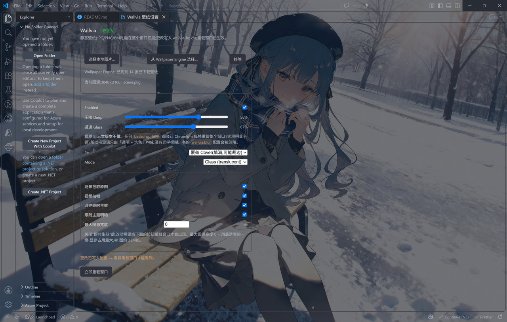
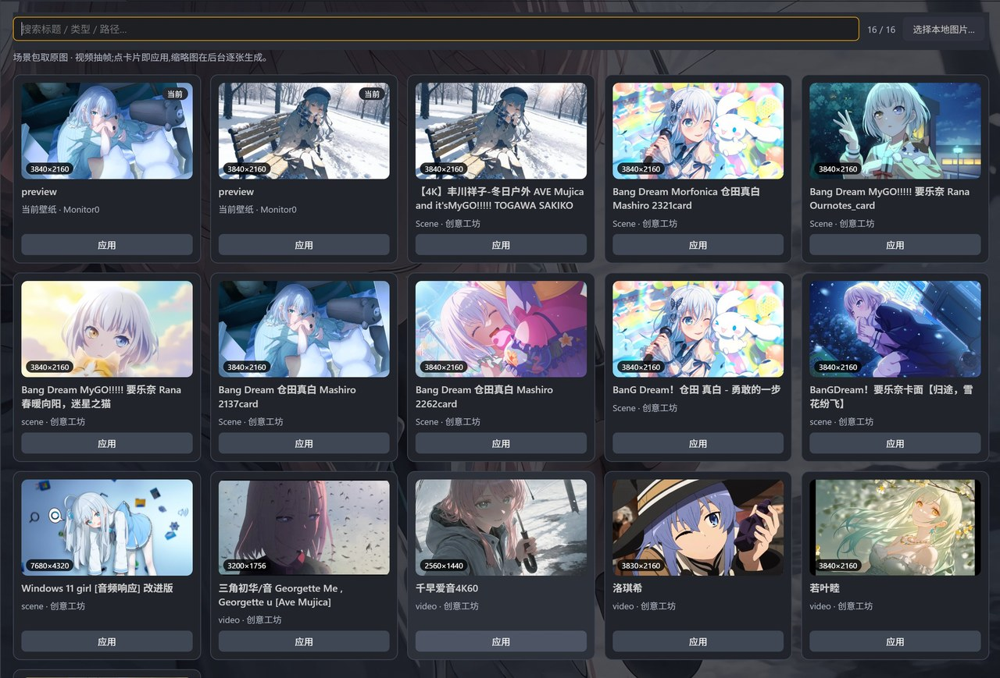
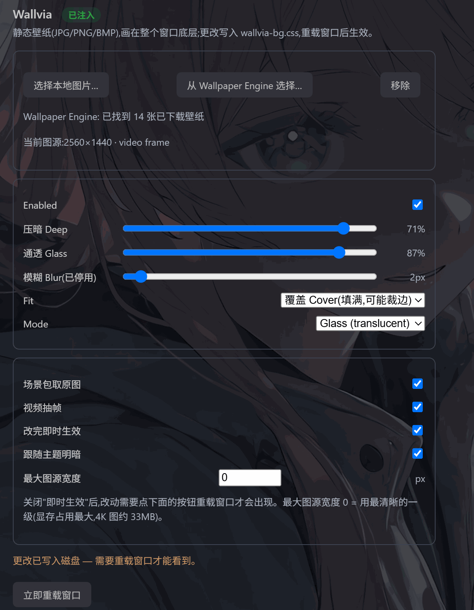
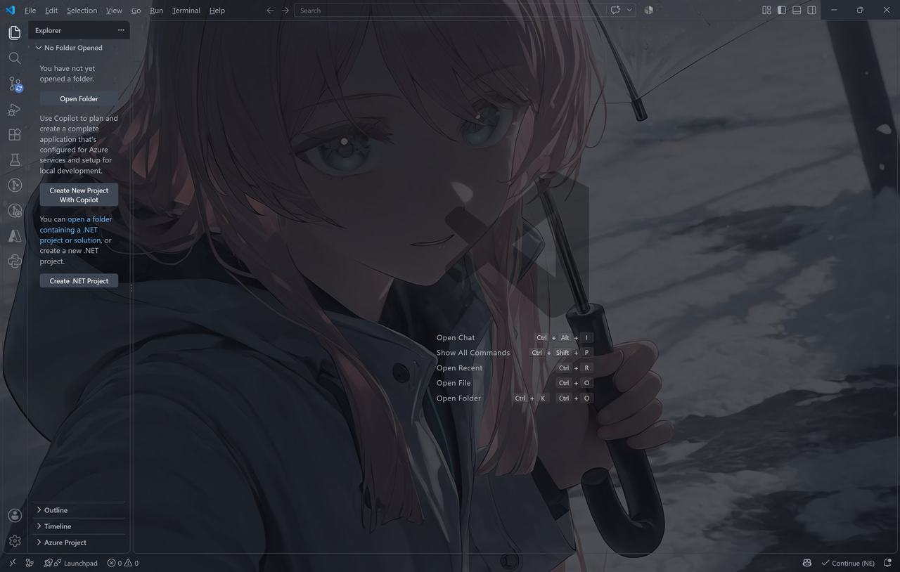

<div align="center">

# Wallvia for VS Code

**Bring your Wallpaper Engine everywhere.**

閫変竴寮犲浘鐗囧綋浣滄暣涓?workbench 鐨勮儗鏅紝缂栬緫鍖轰笌闈㈡澘鍙樻垚鍗婇€忔槑姣涚幓鐠冿紝鏂囧瓧渚濈劧娓呮櫚銆?
[](LICENSE)


涓枃 路 [English](README.md)

</div>



<sub>VS Code 瀹炴祴锛氬绾搁摵婊＄獥鍙ｏ紝娲诲姩鏍?/ 鏍囬鏍?/ 鐘舵€佹爮閫忔槑锛岀紪杈戝櫒鍗婇€忔槑锛涘彸渚ф槸 Wallvia 璁剧疆闈㈡澘锛堟敞鍏ョ姸鎬併€佹湰鏈哄绾稿簱銆佹晥鏋滄粦鏉嗕笌寮€鍏筹級銆?/sub>

---

## 鐩綍

- [鐗规€(#鐗规€?
- [绯荤粺瑕佹眰](#绯荤粺瑕佹眰)
- [瀹夎](#瀹夎)
- [浣跨敤](#浣跨敤)
- [璁剧疆鍙傝€僝(#璁剧疆鍙傝€?
- [宸ヤ綔鍘熺悊](#宸ヤ綔鍘熺悊)
- [鍗歌浇涓庤繕鍘焆(#鍗歌浇涓庤繕鍘?
- [楠岃瘉](#楠岃瘉)
- [宸茬煡闄愬埗](#宸茬煡闄愬埗)
- [鐩綍缁撴瀯](#鐩綍缁撴瀯)
- [鑷磋阿](#鑷磋阿)

## 鐗规€?
| 鐗规€?| 璇存槑 |
|:--|:--|
| **鐩存帴閫?Wallpaper Engine 澹佺焊** | 鍗＄墖缃戞牸鍒楀嚭鏈満**宸蹭笅杞?*鐨勫绾革紙鍒涙剰宸ュ潑 + 鎴戠殑椤圭洰 + 鍐呯疆锛夛紝16:9 澶у浘 + **鍒嗚鲸鐜囪鏍?* + 鎼滅储妗嗭紝姝ｅ湪浣跨敤鐨勯偅寮犳爣銆屽綋鍓嶃€?|
| **鍘熷浘浼樺厛锛屼笉鏄柟鍥鹃瑙?* | 鍦烘櫙澹佺焊浠?`scene.pkg` 鐨?mipmap 閾惧彇鐪熷疄鐢婚潰锛堝疄娴?3840脳2160 / 7680脳4320锛夛紝涓嶇敤 801鈥?024 鐨勬柟褰㈤瑙堝浘锛涘唴缃?/ web 椤圭洰鎵弿 `materials/`銆乣images/` 閲岀殑瀹藉浘 |
| **瑙嗛澹佺焊涔熸湁涓€甯х湡鐢婚潰** | 鐢辩紪杈戝櫒鑷甫鐨?Chromium 瑙ｇ爜锛堢灞?`<video>` + canvas锛夛紝**涓嶈 ffmpeg銆佷笉鍔犱换浣曚緷璧?* |
| **鍥涚瀵归綈** | **瑕嗙洊 cover** / **鍖呭惈 contain**锛堟暣鍥句笉瑁佸壀锛岀暀杈癸級/ **濉厖 fill** / **灞呬腑 center** |
| **鍘嬫殫灞?* | `dim` 淇濊瘉鑺卞摠澹佺焊涓婄殑鏂囧瓧渚濈劧娓呮櫚锛屽苟鍙?*璺熼殢涓婚鏄庢殫**锛堟殫鑹茬敤杩戦粦銆佷寒鑹茬敤杩戠櫧锛?|
| **閫氶€忓害** | `glass` 0-100锛?00 = 缂栬緫鍣ㄥ嚑涔庡畬鍏ㄩ€忓嚭澹佺焊锛? = 鎺ヨ繎涓嶉€忔槑銆備晶鏍忎笌闈㈡澘濮嬬粓閫忔槑锛屽彲璇绘€х敱 `dim` 淇濊瘉 |
| **鍗虫椂鐢熸晥** | 鏀硅缃?/ 鎹㈠绾镐笉閲嶈浇绐楀彛锛氭敞鍏ョ殑灏忚剼鏈疆璇竴涓?stamp 鏂囦欢骞?*灏卞湴鏇挎崲鏍峰紡琛?*锛堝彲鍏筹級 |
| **鍥惧舰璁剧疆闈㈡澘** | 婊戞潌 + 寮€鍏?+ 瀹炴椂鐘舵€侊紙琛ヤ竵鏄惁宸叉敞鍏ャ€佸凡鎵惧埌澶氬皯寮犲绾搞€佸綋鍓嶅浘婧愮殑鍒嗚鲸鐜囦笌鏉ユ簮锛?|
| **鏇存柊鑷姩閲嶆墦** | VS Code 鍗囩骇浼氭竻鎺夎ˉ涓侊紝鎵╁睍鍚姩鏃舵娴嬬増鏈苟鑷姩閲嶅啓 |
| **骞傜瓑 + 澶囦唤 + 涓€閿繕鍘?* | 鍙姩鑷繁甯︽爣璁扮殑浠ｇ爜鍧楋紝鍘熸枃浠剁暀澶囦唤锛屼竴鏉″懡浠よ繕鍘熷畨瑁呯洰褰?|

## 绯荤粺瑕佹眰

| 椤圭洰 | 瑕佹眰 |
|:--|:--|
| VS Code | **1.80+**锛堟闈㈢増锛?|
| 瀹夎鐩綍 | 瀵?VS Code **瀹夎鐩綍**鏈夊啓鏉冮檺锛屾槸鍚﹂渶瑕佺鐞嗗憳瑙佷笅琛?|
| 澶栭儴绋嬪簭 | 涓嶉渶瑕佷换浣曞閮ㄧ▼搴忥細娌℃湁 ffmpeg銆佹病鏈?npm 渚濊禆銆佹病鏈夋瀯寤烘楠?|

| 瀹夎浣嶇疆 | 闇€瑕佺鐞嗗憳锛?|
|:--|:--|
| `%LOCALAPPDATA%\Programs\Microsoft VS Code`锛堢敤鎴风骇瀹夎锛?| 鍚?|
| 闈?Program Files 鐨勮嚜瀹氫箟鐩綍锛堝 `D:\Microsoft VS Code`锛?| 鍚︼紙瀹炴祴鍙啓锛?|
| `C:\Program Files\...` | 閫氬父闇€瑕?|

> 鈿狅笍 **浠呮湰鏈烘闈㈢増鏈夋晥銆?* 鏈墿灞曢€氳繃淇敼瀹夎鐩綍鐨?`workbench.html` 瀹炵幇鑳屾櫙鍥撅紝
> 鎵€浠ュ湪 vscode.dev / 缃戦〉鐗?/ Remote-SSH / Dev Containers 閲岃涓婁篃涓嶄細鐢熸晥銆?
## 瀹夎

| 鏂瑰紡 | 鍏ュ彛 | 閫傚悎 |
|:--|:--|:--|
| **A** | 涓€琛屼笅杞藉苟瀹夎 | 鏈€鐪佷簨锛屼笁琛岄兘鑷姩鍙栨渶鏂扮増 |
| **B** | 宸插厠闅嗕粨搴撴椂鐩存帴瑁呮湰鍦板寘 | 鎵嬮噷宸茬粡鏈?`.vsix` |
| **C** | 浠庢簮鐮佹墦鍖?| 鑷繁鏋勫缓瀹夎鍖?|
| **D** | 寮€鍙戞ā寮忚皟璇?| 鏀逛唬鐮侊紝鎸?<kbd>F5</kbd> 璧疯皟璇曞涓?|
| **E** | 鎵嬪姩鏀惧叆鎵╁睍鐩綍 | 涓嶇粡杩囧懡浠よ |

### 鏂瑰紡 A锛氫竴琛屼笅杞藉苟瀹夎锛堟渶鐪佷簨锛?
```powershell
$r = irm https://api.github.com/repos/Maplelia/Wallvia/releases/latest
$u = ($r.assets | Where-Object name -like '*.vsix').browser_download_url
irm $u -OutFile "$env:TEMP\wallvia.vsix"; code --install-extension "$env:TEMP\wallvia.vsix"
```

涓夎閮借嚜鍔ㄥ彇**鏈€鏂扮増**锛堜笉鍐欐鐗堟湰鍙凤紝浠ュ悗鍙戠増涔熶笉浼?404锛夈€傛兂閿佸畾鐗堟湰灏辩洿鎺ユ寚瀹氾紝渚嬪锛?`https://github.com/Maplelia/Wallvia/releases/download/v<version>/wallvia-<version>.vsix`

### 鏂瑰紡 B锛氬凡鍏嬮殕浠撳簱鏃剁洿鎺ヨ鏈湴鍖?
```powershell
code --install-extension (Get-ChildItem *.vsix | Select-Object -Last 1).FullName
```

### 鏂瑰紡 C锛氫粠婧愮爜鎵撳寘

```powershell
npx @vscode/vsce package --allow-missing-repository
code --install-extension .\wallvia-<鐗堟湰>.vsix   # 鐗堟湰鍙疯 package.json
```

### 鏂瑰紡 D锛氬紑鍙戞ā寮忚皟璇?
鏈洰褰曞甫 `.vscode/launch.json`锛岀洿鎺ュ湪 VS Code 閲屾寜 <kbd>F5</kbd>銆?
### 鏂瑰紡 E锛氭墜鍔ㄦ斁鍏ユ墿灞曠洰褰?
鎶婃湰鐩綍澶嶅埗鍒?`%USERPROFILE%\.vscode\extensions\wallvia.wallvia-<鐗堟湰>\` 鍚庨噸鍚€?
> 瑁呭畬**閲嶈浇涓€娆＄獥鍙?*锛堝懡浠ら潰鏉?鈫?`Developer: Reload Window`锛夛細鎵╁睍棣栨婵€娲讳細鍐欏ソ琛ヤ竵锛?> 鑰?`workbench.html` 鍙湪绐楀彛鍚姩鏃惰鍙栦竴娆°€?
## 浣跨敤

鍛戒护闈㈡澘锛?kbd>Ctrl</kbd>+<kbd>Shift</kbd>+<kbd>P</kbd>锛夎緭鍏?**`wallvia`** 鈥斺€?鎵€鏈夊懡浠ょ粺涓€浠?`Wallvia:` 寮€澶达紝鎵€浠ユ悳鍝佺墝鍚嶅繀鐒跺懡涓紱鎼?`wallpaper engine` 涔熻兘鎵惧埌閫夋嫨鍣ㄩ偅鏉°€?
| 鍛戒护 | 浣滅敤 |
|:--|:--|
| **Wallvia: Choose Wallpaper Engine Wallpaper鈥?* | 鎵撳紑鍗＄墖缃戞牸閫夋嫨鍣紙**棣栭€?*锛?|
| **Wallvia: Choose Image File鈥?* | 閫夋湰鍦伴潤鎬佸浘锛圝PG / PNG / BMP锛夊苟搴旂敤 |
| **Wallvia: Open Settings Panel** | 鍥惧舰闈㈡澘锛氭晥鏋滄粦鏉?+ 鍥涗釜鍙€夊紑鍏?+ 鍥炬簮瀹藉害涓婇檺 |
| **Wallvia: Toggle Glass Effect** | `glass` 鈫?`fade` 鍒囨崲 |
| **Wallvia: Remove Wallpaper** | 绉婚櫎澹佺焊锛堝苟鍒犻櫎宸叉嫹璐濈殑鍥剧墖锛?|
| **Wallvia: Show Status** | 杈撳嚭鐘舵€?JSON锛堟帓闅滅敤锛屽惈褰撳墠鍥炬簮涓庡垎杈ㄧ巼锛?|
| **Wallvia: Restore Original workbench.html** | 浠庡浠借繕鍘熷畨瑁呯洰褰曪紝鍒犳帀鐢熸垚鐨?CSS / 鑴氭湰 / stamp |

> 鍘嗗彶鎻愮ず锛?.1.x 閲屽懡浠ゅ彨 `Wallpaper: Pick Image鈥 绛夛紝涓旀寕鍦?`Glass Wallpaper` 鍒嗙被涓嬶紱
> 0.2.0 璧风粺涓€涓?`Wallvia:` 鍓嶇紑銆?
### Wallpaper Engine 澹佺焊閫夋嫨鍣?


<sub>Wallpaper Engine 閫夋嫨鍣細鍗＄墖缃戞牸 + 鍒嗚鲸鐜囪鏍囷紙鎴浘閲?3840脳2160 鐨勫満鏅€?200脳1756 / 2560脳1440 / 3830脳2160 鐨勮棰戝抚锛夛紝銆屽綋鍓嶃€嶆槸姝ｅ湪鐢熸晥鐨勯偅寮狅紝鐐瑰崱鐗囧嵆搴旂敤銆?/sub>

## 璁剧疆鍙傝€?
| 璁剧疆椤?| 鍙栧€?| 榛樿 | 璇存槑 |
|:--|:--|:--|:--|
| `wallvia.enabled` | boolean | `true` | 鏄惁鍚敤澹佺焊 |
| `wallvia.dim` | 0-80 | `45` | 鍘嬫殫灞傚己搴︼紙%锛夈€備寒鍥惧缓璁?40-60 |
| `wallvia.glass` | 0-100 | `55` | 閫氶€忓害锛?锛夈€?00 鏃剁紪杈戝櫒搴曡壊鏈€娣★紝0 鏃舵帴杩戜笉閫忔槑 |
| `wallvia.mode` | `glass` \| `fade` | `glass` | `fade` 鍙繚鐣欎竴灞傛洿娣＄殑娲楄壊锛屾渶绋?|
| `wallvia.fit` | `cover` \| `contain` \| `fill` \| `center` | `cover` | **瑕嗙洊**濉弧锛堝彲鑳借杈癸級/ **鍖呭惈**鏁村浘涓嶈鍓紙鐣欐繁鑹茶竟锛? **濉厖**鎷変几 / **灞呬腑**鍘熷澶у皬 |
| `wallvia.hires` | boolean | `true` | 鍦烘櫙鍖呭彇鍘熷鍒嗚鲸鐜囧ぇ鍥撅紱鍏虫帀鍒欏彧鐢?801鈥?024 鐨勯瑙堝浘 |
| `wallvia.videoFrames` | boolean | `true` | 瑙嗛澹佺焊鎶戒竴甯у綋缂╃暐鍥?/ 鑳屾櫙锛圕hromium 瑙ｇ爜锛屾棤闇€ ffmpeg锛?|
| `wallvia.liveApply` | boolean | `true` | 鏀瑰姩鍗虫椂鐢熸晥锛涘叧鎺夊悗鏀瑰姩闇€鎵嬪姩閲嶈浇绐楀彛 |
| `wallvia.themeAware` | boolean | `true` | 鍘嬫殫灞傞鑹茶窡闅忎富棰樻槑鏆?|
| `wallvia.maxImageWidth` | 0-7680 | `0` | 鍥炬簮瀹藉害涓婇檺銆俙0` = 鍦烘櫙鍙栨渶娓呮櫚涓€绾с€佽棰戝崱鐗囧抚 960锛涜 1920/2560 鍙樉钁楅檷浣庢樉瀛樹笌瑙ｇ爜寮€閿€锛岃澶у€煎垯璁╄棰戝崱鐗囧抚涓€璧峰彉娓呮櫚 |
| `wallvia.autoReapply` | boolean | `true` | VS Code 鏇存柊鍚庤嚜鍔ㄩ噸鎵撹ˉ涓?|
| `wallvia.blur` | 0-12 | `0` | **宸插仠鐢?*锛堜繚鐣欓敭鍙负璁╄€侀厤缃笉鎶ラ敊锛夛細浠讳綍 `backdrop-filter` 閮戒細璁?Chromium 姣忓抚閲嶇粯鏁翠釜绐楀彛锛屽唴閮ㄥ浐瀹氭寜 0 澶勭悊 |

### 鍥惧舰璁剧疆闈㈡澘



<sub>璁剧疆闈㈡澘锛氬乏涓婅寰芥爣鏄剧ず琛ヤ竵鏄惁宸叉敞鍏ワ紝骞跺垪鍑烘娴嬪埌鐨?Wallpaper Engine 澹佺焊鏁伴噺涓?*褰撳墠鍥炬簮**锛堝垎杈ㄧ巼 + 鏉ユ簮锛夛紱涓嬪崐閮ㄥ垎鏄彲閫夌殑鍥涗釜寮€鍏充笌鍥炬簮瀹藉害涓婇檺銆?/sub>

## 宸ヤ綔鍘熺悊

VS Code **娌℃湁浠讳綍瀹樻柟 API** 鑳借缃暣涓?workbench 鐨勮儗鏅浘
锛圼#134317](https://github.com/microsoft/vscode/issues/134317)銆?[#6007](https://github.com/microsoft/vscode/issues/6007) 澶氬勾鏈疄鐜帮級锛?绀惧尯鎵€鏈夎儗鏅被鎵╁睍璧扮殑閮芥槸銆屾敼瀹夎鐩綍鏂囦欢銆嶈繖鏉¤矾銆傛湰鎵╁睍鐨勫仛娉曪細

1. 鍥剧墖鎷峰叆鎵╁睍 `globalStorage`锛?*淇濈暀鐪熷疄鎵╁睍鍚?*锛岄伩鍏?mime 涓庡唴瀹逛笉绗︼級锛?2. 鍦?`workbench.html` 鍚岀洰褰曠敓鎴?`wallvia-bg.css`锛堝繀瑕佹椂杩樻湁 `wallvia-live.js` 涓?`wallvia-stamp.txt`锛夛紱
3. 寰€ `<head>` 娉ㄥ叆涓€娈靛甫鏍囪鐨?`<link>`锛堝箓绛夛紝鍙姩鑷繁鐨勬爣璁板潡锛夛紱
4. 鍚屾 `product.json` 鐨?`checksums`锛岄伩鍏嶃€屽畨瑁呭凡鎹熷潖銆嶈鍛婏紱
5. 鍘熸枃浠跺浠戒负 `workbench.html.wallvia.bak`銆?
### 娓叉煋妯″瀷锛氫竴灞傚绾?+ 涓€灞傛礂鑹?+ 閫忔槑琛ㄩ潰

```css
html body::before  { position:fixed; inset:0; z-index:0; background-image:url(澹佺焊) }  /* 鍞竴鐨勫绾稿眰 */
html body::after   { position:fixed; inset:0; z-index:1; background:rgba(8,10,18,dim) } /* 鍞竴鐨勫帇鏆楀眰 */
html body .monaco-workbench { position:relative; z-index:2; background:transparent }     /* 琛ㄩ潰鍏ㄩ儴閫忔槑 */
```

澹佺焊**缁濅笉**鐢诲湪渚ф爮 / 闈㈡澘鍚勮嚜鐨?`background-image` 涓婏細閭ｆ牱姣忎釜琛ㄩ潰鍚勭敾涓€閬嶏紝
鏃㈤噸澶嶈В鐮佸張浼氬湪绐楀彛鏀瑰彉澶у皬鏃跺嚭鐜版帴缂濓紙鏃╂湡鐗堟湰灏辨槸杩欎箞鍋氱殑锛屽凡搴熷純锛夈€?


<sub>渚ф爮銆佺紪杈戝櫒銆佺粓绔潰鏉垮悓鏃舵墦寮€鏃讹紝澹佺焊鍦ㄥ洓涓尯鍩熸槸**杩炵画**鐨?鈥斺€?渚ф爮涓嶆槸涓€鍧椾笉閫忔槑鍗＄墖銆?/sub>

### 涓変釜蹇呴』韪╁鐨勭粏鑺傦紙鍏ㄩ儴鍦ㄧ湡瀹?workbench 閲屽疄娴嬭繃锛?
| 缁嗚妭 | 鍋氶敊鐨勫悗鏋?|
|:--|:--|
| `checksums` 蹇呴』鏄?**sha256 鐨?base64銆佸幓鎺?`=` 濉厖**锛?3 瀛楃锛?| 鍐欐垚 hex 鈫?姣忔鍚姩寮?*"Your Code installation appears to be corrupt"* |
| 鍥剧墖 URI 蹇呴』**鐧惧垎鍙风紪鐮?*锛岀敤 `vscode.Uri.file(p).with({scheme:'vscode-file',authority:'vscode-app'})` | 璺緞鍚┖鏍兼垨涓枃鏃讹紙Windows 鏋佸父瑙侊級娓叉煋鍣ㄦ嫆缁濆姞杞?|
| 澹佺焊灞傜殑 `z-index` 鐢?**0 / 1 / 2 姝ｅ眰**锛屼笉瑕佺敤璐熷€?| 璐?`z-index` 浼氳 `.monaco-workbench` 鑷繁鐨勫眰鍙犱笂涓嬫枃鍓帀 鈫?**澹佺焊瀹屽叏涓嶆樉绀?* |

### 涓ゅ銆屾竻搴曘€嶆満鍒讹紙缂轰竴涓嶅彲锛?
workbench 閲岀殑琛ㄩ潰鐢ㄤ袱绉嶆柟寮忚鐢讳笂棰滆壊锛屽繀椤诲垎鍒浠橈細

1. **`!important` 鐨勯€夋嫨鍣?* 鈥斺€?鐢ㄤ竴鏉℃洿鍏蜂綋銆佸悓鏍?`!important` 鐨勮鍒欏帇杩囧幓銆?   涓€瀹氳鐓ф妱 VS Code 鐪熷疄鐨勭被閾撅紝渚嬪鐜颁唬 UI锛?.140+锛夌殑娴姩鍗＄墖锛?
   ```css
   .monaco-workbench.floating-panels .part.sidebar { background-color: var(--vscode-surface-background) !important }
   ```

   杩欐槸 **(0,4,0)** 鏉冮噸銆傚啓鎴?`html body .monaco-workbench .part.sidebar` 鍙湁 (0,3,2)锛?   **浼氳緭** 鈥斺€?鐜拌薄灏辨槸銆屽绾搁摵婊℃暣绐楋紝浣嗕晶鏍忚繕鏄竴鍧椾笉閫忔槑鍗＄墖銆嶃€?
2. **涓婚鍙橀噺** 鈥斺€?澶ч噺琛ㄩ潰鏄€氳繃涓婚鍙橀噺涓婅壊鐨勶紙`--vscode-tab-inactiveBackground` 涔嬬被锛夛紝
   鎶婅繖浜涘彉閲忓湪 `.monaco-workbench` 涓婄疆涓?`transparent`锛屽氨鏃犻渶閫愪釜琛ㄩ潰鍐欒鍒欙細

   ```css
   html body .monaco-workbench { --vscode-editor-background: transparent; --vscode-sideBar-background: transparent;
                                 --vscode-surface-background: transparent; --modern-ui-shell-background: transparent; 鈥?}
   ```

`tests/vscode-css-weight.cjs` 浼氭妸**鐪熷疄瀹夎鐩綍閲岀殑 `workbench.desktop.main.css`** 瑙ｆ瀽鍑烘潵锛?閫愭潯妫€鏌ャ€屾瘡鏉＄粰缁撴瀯琛ㄩ潰涓婅壊鐨勮鍒欍€嶆槸鍚﹂兘琚笂闈袱濂楁満鍒朵箣涓€鐩栦綇锛屾墍浠?VS Code 鎹㈢増鏈€佹敼绫诲悕鏃朵細
绔嬪埢鎶ヨ锛岃€屼笉鏄瓑浣犲彂鐜颁晶鏍忓張鍙樹笉閫忔槑浜嗐€?
### 鍗虫椂鐢熸晥锛堜笉閲嶈浇绐楀彛锛?
`workbench.html` 鍙湪绐楀彛鍚姩鏃惰涓€娆★紝鎵€浠ユ棭鏈熺増鏈瘡娆℃敼璁剧疆閮借閲嶈浇鏁翠釜绐楀彛銆傜幇鍦?`applyPatch()` 浼氶澶栧啓锛?
- `wallvia-live.js` 鈥斺€?涓€娈靛皬鑴氭湰锛屾瘡 2 绉?`fetch('./wallvia-stamp.txt')`锛?- `wallvia-stamp.txt` 鈥斺€?CSS 鐨?mtime 鎴炽€?
stamp 鍙樹簡灏?*灏卞湴鏀瑰啓 `<link href>`**锛屾祻瑙堝櫒閲嶆柊璇诲彇鏍峰紡琛紝绐楀彛鍏朵綑閮ㄥ垎瀹屽叏涓嶅姩銆?锛坵orkbench 鐨?CSP 鏈?`require-trusted-types-for 'script'`锛屾墍浠ヤ笉鑳界敤鍔ㄦ€佹彃 `<script>` 鐨勬柟寮忥紝
鍙兘 `fetch` + 鏀?`href`锛沗connect-src 'self'` 鍏佽杩欎釜 fetch銆傦級

## 鍗歌浇涓庤繕鍘?
涓€鏉″懡浠ゅ嵆鍙細

```
Wallvia: Restore Original workbench.html
```

瀹冧細鎶婂浠借鐩栧洖鍘伙紝鍒犻櫎 `wallvia-bg.css`銆乣wallvia-live.js`銆乣wallvia-stamp.txt`锛屽苟閲嶇畻
`product.json` 鈫?`checksums`銆?
鎵嬪伐姝ラ锛堢瓑浠凤級锛?
1. 鐢?`workbench.html.wallvia.bak` 瑕嗙洊 `workbench.html`锛?2. 鍒犻櫎 `<!-- wallvia:start -->` 鈥?`<!-- wallvia:end -->` 鏍囪鍧楋紱
3. 鍒犻櫎鍚岀洰褰曠殑 `wallvia-bg.css` / `wallvia-live.js` / `wallvia-stamp.txt`锛?4. 閲嶇畻 `product.json` 鈫?`checksums["vs/code/electron-browser/workbench/workbench.html"]`锛?5. 鍗歌浇鎵╁睍锛堢紦瀛樼洰褰?`globalStorage/wallvia.wallvia/` 涓?`%TEMP%\wallvia-stills\` 鍙竴骞跺垹闄わ級銆?
## 楠岃瘉

```powershell
node tests/run-all.cjs             # 鍏ㄥ锛堜粠浠撳簱鏍圭洰褰曡窇锛?node tests/vscode-smoke.cjs        # VS Code 鎵╁睍锛氭敞鍏?/ 鏍￠獙鍜?/ 閫夋嫨鍣?/ 瑙嗛甯у線杩旓紙鍋囧畨瑁呯洰褰曪級
node tests/vscode-video-frame.cjs  # 甯х紦瀛樸€佸搴︾瓥鐣ャ€佸潖杞借嵎鎷掓敹
node tests/vscode-video-decode.cjs # 鐪?Chromium + 鐪熻棰戯細鎶藉抚鍑芥暟鏈韩锛堟棤娴忚鍣ㄥ垯 SKIP锛?node tests/vscode-css-weight.cjs   # 鐢ㄧ湡瀹?VS Code 鏍峰紡琛ㄦ牎楠屾竻搴曟潈閲嶏紙娌¤ VS Code 鍒?SKIP锛?```

| 鍛戒护 | 瑕嗙洊鑼冨洿 |
|:--|:--|
| `node tests/run-all.cjs` | 鍏ㄥ锛屼粠浠撳簱鏍圭洰褰曡窇 |
| `node tests/vscode-smoke.cjs` | 娉ㄥ叆 / 鏍￠獙鍜?/ 閫夋嫨鍣?/ 瑙嗛甯у線杩旓紙鍋囧畨瑁呯洰褰曪級 |
| `node tests/vscode-video-frame.cjs` | 甯х紦瀛樸€佸搴︾瓥鐣ャ€佸潖杞借嵎鎷掓敹 |
| `node tests/vscode-video-decode.cjs` | 鐪?Chromium + 鐪熻棰戯細鎶藉抚鍑芥暟鏈韩锛堟棤娴忚鍣ㄥ垯 SKIP锛?|
| `node tests/vscode-css-weight.cjs` | 鐢ㄧ湡瀹?VS Code 鏍峰紡琛ㄦ牎楠屾竻搴曟潈閲嶏紙娌¤ VS Code 鍒?SKIP锛?|

## 宸茬煡闄愬埗

- 浠呮闈㈢増锛汻emote / Web 涓嶉€傜敤銆?- **Wallpaper Engine 閫夋嫨鍣ㄤ粎 Windows 妗岄潰绔?*锛氬畾浣嶆柟寮忎负 杩愯涓殑 WE 杩涚▼ 鈫?Steam 娉ㄥ唽琛?鈫?  甯歌瀹夎鐩綍锛堜篃鍙敤鐜鍙橀噺 `WE_CONFIG` 鎸囧悜 `config.json` 寮哄埗鎸囧畾锛夈€?- **鍔ㄦ€佸唴瀹逛笉浼氬姩**锛歏S Code 鍙兘鐢婚潤鎬佽儗鏅€傚満鏅绾稿彇鍖呭唴鍘熷鐢婚潰锛岃棰戝绾稿彇涓€甯э紝
  鍐呯疆榛樿椤圭洰鐨?DXT/TGA 璐村浘鏃犳硶瑙ｇ爜锛屽彧鑳界敤 WE 鑷甫鐨勬柟褰㈤瑙堝浘銆?- 鏈畨瑁?WE 鏃惰鍛戒护浼氭槑纭彁绀猴紝鍙户缁敤銆岄€夋嫨鏈湴鍥剧墖鏂囦欢銆嶃€?- VS Code 鏇存柊浼氳鐩栬ˉ涓侊紝渚濊禆鎵╁睍鍚姩鏃剁殑鑷姩閲嶆墦銆?- **缂栬緫鍣ㄥ尯鍩熺殑涓嶉€忔槑搴︾敱 `glass` 鍐冲畾**锛歁onaco 鎶?`--vscode-editor-background` 鍚屾椂鐢诲湪
  `.monaco-editor` 鍜?`.monaco-editor-background` 涓ゅ眰涓婏紝涓ゅ眰閮借澶勭悊锛屽惁鍒欎竴鎵撳紑鏂囦欢缂栬緫鍣ㄥ氨鏄?  涓€鍧楃函榛戯紙绌虹紪杈戝櫒鐪嬩笉鍑洪棶棰橈紝鍥犱负閭ｆ椂 Monaco 鏍规湰娌＄敾鎺т欢锛夈€傛兂鏇存竻妤氬湴鐪嬪埌澹佺焊锛屾妸
  `wallvia.glass` 璋冨埌 100銆?- `glass` 妯″紡渚濊禆 `.part.*` 绛?DOM 缁撴瀯锛屽ぇ鐗堟湰鏇存柊鍚庝釜鍒€夋嫨鍣ㄥ彲鑳藉け鏁堬紝姝ゆ椂鍒?`fade`
  锛堟垨璺戞潈閲嶆祴璇曞畾浣嶏級銆?.140 鐨勩€屾诞鍔ㄥ崱鐗囥€嶇幇浠?UI 宸蹭笓闂ㄩ€傞厤銆?- **涓嶅仛鍏夊妯＄硦**锛氫换浣?`backdrop-filter` 閮戒細璁?Chromium 姣忓抚閲嶇粯鏁翠釜绐楀彛锛屼唬浠疯繙澶т簬鏀剁泭锛?  鎵€浠ユ瘺鐜荤拑鍙敱銆岄€忔槑 + 娲楄壊銆嶆瀯鎴愶紝`wallvia.blur` 淇濈暀浣嗗浐瀹氫笉鐢熸晥銆?- 4K 鍥炬簮瑙ｇ爜鍚庣害鍗?33MB 鏄惧瓨锛涘湪鎰忕殑璇濈敤 `wallvia.maxImageWidth` 闄愬埗鍒?1920/2560銆?- 淇敼瀹夎鐩綍鏈川涓婃槸 hack锛岃鑷璇勪及椋庨櫓锛涙湰鎵╁睍鍙仛鏈€灏忔敼鍔ㄥ苟淇濈暀澶囦唤銆?
## 鐩綍缁撴瀯

```
.
鈹溾攢鈹€ package.json             # 鍛戒护涓庤缃０鏄?鈹溾攢鈹€ src/extension.js         # 鎵╁睍涓讳綋锛氭墦琛ヤ竵 / 鐢熸垚 CSS / 閫夋嫨鍣ㄤ笌璁剧疆闈㈡澘锛堢函 CJS锛屾棤闇€鏋勫缓锛?鈹溾攢鈹€ src/wallpaper-engine.js  # Wallpaper Engine 瀹氫綅 + 宸蹭笅杞藉绾告灇涓?鈹溾攢鈹€ src/still-image.js       # 浠?scene.pkg 鐨?.tex / 椤圭洰鏁ｅ浘閲屽彇鍑烘渶鍚堥€傜殑闈欏浘
鈹溾攢鈹€ src/video-frame.js       # 瑙嗛甯х紦瀛橈細閿€佸搴︾瓥鐣ャ€佸潖杞借嵎鏍￠獙锛堜笌 Obsidian 鍏辩敤鍚屼竴鐩綍锛?鈹溾攢鈹€ src/mp4.js               # 绾瓧鑺傝В鏋?MP4 鐨?tkhd锛屽彇瑙嗛鑷韩鍒嗚鲸鐜?鈹溾攢鈹€ scripts/verify.js        # 鍙戝竷鍓嶄竴鑷存€ф鏌ワ紙vsce 鐨?prepublish 浼氳皟鐢級
鈹溾攢鈹€ images/                  # README 鎴浘
鈹溾攢鈹€ LICENSE
鈹溾攢鈹€ README.md              # 鑻辨枃(榛樿)
鈹斺攢鈹€ README.zh.md           # 涓枃
```

杩愯鏃跺湪 VS Code 瀹夎鐩綍閲岀敓鎴愶紙鍗歌浇 / 杩樺師鏃跺垹闄わ級锛?
```
resources/app/out/.../workbench/wallvia-bg.css      # 澹佺焊 + 娲楄壊 + 娓呭簳
resources/app/out/.../workbench/wallvia-live.js     # 鍗虫椂鐢熸晥鑴氭湰
resources/app/out/.../workbench/wallvia-stamp.txt   # 鏍峰紡琛ㄧ増鏈埑
```

## 鑷磋阿

CSS 閫夋嫨鍣ㄤ笌骞冲彴鐗规€у弬鑰冪ぞ鍖鸿儗鏅被鎵╁睍锛?[shalldie/vscode-background](https://github.com/shalldie/vscode-background)銆?[subframe7536/vscode-custom-ui-style](https://github.com/subframe7536/vscode-custom-ui-style)銆?[KatsuteDev/Background](https://github.com/KatsuteDev/Background)銆?鐜荤拑澹佺焊鐨勬€濊矾婧愯嚜涓€涓?MIT 璁稿彲鐨勪笂娓稿绾告彃浠躲€?
[MIT](LICENSE) 漏 2026 Wallvia contributors
